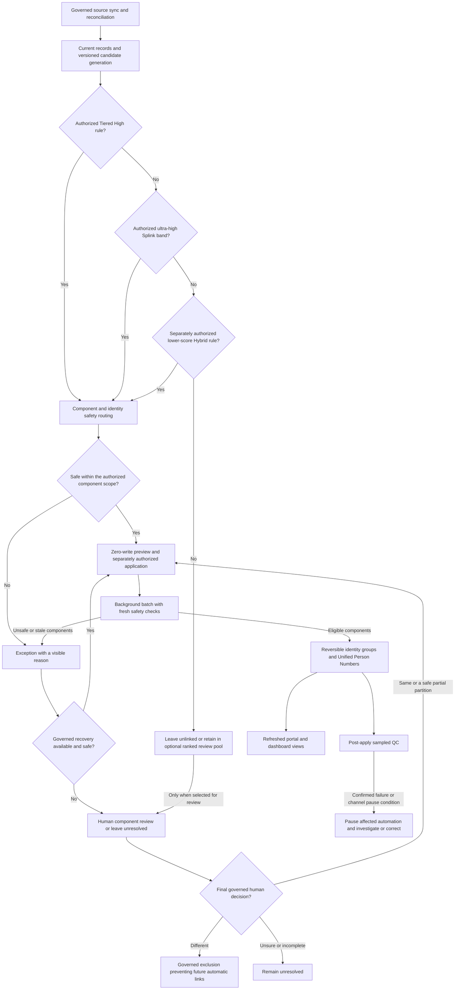

# CCD recommended operating model — November 2026

**Presentation edition: 18 November 2026.** This is a new, dated companion to
[the August POC report](POC_REPORT.md), not a replacement. Its original results,
recommendations and diagram remain historical evidence and are unchanged.

This document describes the evolved **Development operating model**. Implemented
capabilities, evidence approval and enabled automation are different things.
Nothing here grants UAT/production deployment approval, transfers an old
authorization to a new population, or changes live settings.

## Recommended operating model — presentation graph

The important change since August is that **not every non-Tiered pair goes
straight to manual review**. There is now an independently authorized ultra-high
Splink route, and a separately governed lower-score Hybrid route where approved.

**How to read the graph:** these are decision routes, not a promise that every
route is enabled or that one button executes all of them. Recommendations are
handled first; subsequent automation must use refreshed identity state. A manual
one-channel cycle does not run all other channels. A human Same label also does
not itself write identity state: application remains a separate governed action.

## Recommended steps

1. **Finish source synchronization and reconciliation.** Check submitted source
   registrations, mappings, staging-to-Master synchronization and Unified Person
   assignment. Resolve reconciliation failures before trusting a new matching
   snapshot. Preserve immutable source identity when registrations are amended.
2. **Use the correct policy and evidence.** Generate candidates through the
   governed canary/review queue. Reuse authorization only where its exact
   policy, model/runtime, source scope and cutoff remain compatible. Material
   changes need the applicable evaluation and authorization workflow; a new
   policy name or a high score alone does not authorize writes.
3. **Process authorized Tiered High first.** Validated deterministic rules
   produce recommendations. Preview/apply safe components through background
   batches. A batch may apply its safe components and retain unsafe ones as
   visible exceptions; it need not abandon all safe work because one component
   fails. Do not split an unsafe component into convenient individual edges.
4. **Process the authorized ultra-high Splink band.** The current Development
   authorization uses **0.997092444** with its frozen `pilot-1.9` evidence.
   This is not the optional Review cutoff, and not a universal threshold for
   future data. Apply only eligible components within the configured run and
   component-size limits. Keep candidate history and probabilistic provenance.
5. **Handle structures, not just pair scores.** Use the separately governed
   one-to-many, incomplete-component and complete-group overlap routes below.
   Increasing a preview size does not make missing evidence, stale records or
   incompatible authorization disappear. Retain genuine conflicts as exceptions.
6. **Use lower-score Hybrid only inside its own authorization.** Score plus
   corroboration is a separate route, not an automatic lowering of the ultra-high
   cutoff. The currently stored Hybrid approval belongs to an older population
   and its automation is disabled; it does not authorize the newer population.
   Otherwise leave lower-score candidates in the optional ranked pool.
7. **Review selectively and apply explicitly.** Ordinary optional candidates are
   not mandatory work. Persistent Desk batches keep selected research/review
   work resumable. Independent reviewers and adjudication are required by the
   applicable validation/QC workflow. Explicit manager overrides remain separate
   from independent human validation and automatic model decisions.
8. **Reconcile, monitor and correct.** Applied components create or expand
   reversible identity groups; maintain Unified Person membership/aliases and
   refresh downstream snapshots. Use sampled ongoing QC and the unified
   workbench. Investigate failures and perform governed correction; never erase
   the original decision history to make metrics look better.

## Structural recovery is now part of the model

| Situation | Current governed route | What still prevents unattended linking |
| --- | --- | --- |
| Ordinary safe Tiered High component | Recommendation activation / Tiered automation | Unauthorized rules or source scope, stale evidence, exclusions and other safety failures |
| Tiered one-to-many, including repeated records from one source | Separate authorized component-level bulk workflow | Hard conflicts, invalid authorization, unsafe component scope or configured size limits |
| Ultra-high pair or complete high-score clique | Splink automation | Current fingerprints, exclusions, source/duplicate concerns, overlap and frozen provenance checks |
| Incomplete ultra-high component | Optional, separately enabled corroborated-incomplete route | Connectivity alone is insufficient: missing edges must satisfy the route's independent corroboration and source constraints |
| Candidate touches an existing identity group | Complete-group overlap recovery for eligible Tiered/Splink exceptions | Expand and assess the whole existing group, not just the convenient pair; reject incompatible members or active Different exclusions |
| Genuine unresolved conflict or unsupported structure | Human component review / explicit governed correction | No forced automatic Same decision |

A **complete clique** means every pair in the component has the required edge.
A three-record chain A–B–C without A–C is not a clique. The incomplete route must
justify the missing edge; it cannot treat transitivity alone as proof.

Missing or partial identifiers are not automatically trusted conflicts. A
`YYYY-01-01` birthday is treated as year-only in the relevant newer evidence
rules: same-year comparisons can support a match and uncertain different-year
comparisons can be neutral. This is not permission to ignore every birthday or
identifier conflict. Complete valid conflicting trusted identifiers and active
Different decisions remain important safety barriers.

## New authorization versus routine operation

**New proposal:** exploratory research, if needed → freeze policy, model, scope,
cutoff/rule, seed and cohorts → independent prospective review and adjudication
→ precision/confidence gate → management approval → separately preview/apply
validation labels → capped blinded rollout → full holdout QC → second approval
for the authorized ongoing route.

The implemented prospective patterns use **165 validation cases and 50 blinded
holdout cases**, subject to the protocol's eligibility/attrition floors. A case
is a pair for pair validation, but a whole component for one-to-many validation.
The actual eligible applied holdout can be smaller than 50. Previously exposed
labels cannot be reused as unseen validation evidence. A failed cohort must not
both select a revised rule/cutoff and approve it.

**Routine operation:** current authorization → bounded preview/batch → safe
application → sampled QC. Do **not** repeat a complete 165/50 exercise for every
unchanged batch, and do not require human review of every ordinary automated
link. Authorization remains bounded by its approved provenance and safety state.

The original 95% lower-bound target must not be quoted as a universal current
Splink requirement: the newer Development proposal explicitly accepted an
**80% Wilson 95% precision lower-bound target**. A score cutoff, observed
precision and a confidence lower bound are three different quantities.

### QC without turning automation into full manual review

- Full independent QC applies to the **applied blinded holdout**, not every
  subsequent link. Ongoing controls use deterministic sampling.
- The normal shared allocation is **20 cases per week** across channels, not
  20 materializations. Mandatory QC takes priority; optional review uses spare
  capacity. Assigned cases require independent reviewers; unselected work has
  no review SLA and must not be displayed as overdue.
- Capacity gating is channel-specific. Development one-to-many currently has an
  **audited non-blocking QC-capacity risk acceptance**: insufficient sampling
  capacity does not itself block that bulk path. It is not a blanket QC bypass
  for all channels, and does not disable hard-conflict checks or correction.
- A confirmed QC failure can suspend the affected group and pause the relevant
  channel. Overdue assigned QC and completed-window precision failures remain
  governed pause conditions. Do not pause unrelated channels merely because
  another channel has failed unless a shared integrity problem is established.

## Where the operator works in Desk

| Task | Desk location / action |
| --- | --- |
| Freeze/evaluate evidence | **CCD Match Evaluation Run** and the governed creation actions on the relevant queue or exploratory batch |
| Ordinary Tiered activation | **CCD Match Canary Run**, its activation actions and **CCD Identity Activation Batch** |
| Routine controls and previews | **CCD Identity Resolution Settings** → **Automation**, **Splink Automation**, **Tiered One-to-Many Automation**, **Automatic Overlap Recovery** or **Development Hybrid Automation** |
| Lower-score exploration | **CCD Hybrid Exploratory Batch** → persistent items → **Prepare Development Validation Proposal** when appropriate |
| Component exceptions | **CCD Match Component Review**; inspect materialization status/reason as well as review status |
| Batch progress and item exceptions | The linked activation, Splink, one-to-many or overlap batch document |
| All assigned QC channels together | **CCD Unified QC Workbench** |
| Identity outcome / correction | **CCD Identity Resolution Register** and the relevant group, decision and governed correction actions |

An old Recommendation's `Exception` or `Superseded` status does not prove the
person is still unlinked. Its component may already have been resolved through
another governed path. Inspect current membership and materialization history.

## Presentation counts: pairs are not people

Read-only Development verification on **18 November 2026** found **3,191 active
linked Unified Person Numbers**. **3,189** span multiple services and match the
current dashboard's cross-unit user count; two groups contain only same-source
duplicates. These are linked people, not the total population of assigned
Unified Person Numbers, and not precision/recall measurements.

For a non-overlapping presentation classification, assign a group to Tiered
High first if it has qualifying Tiered evidence; use ultra-high-only second.
This is a reporting convention, **not a rewrite of the actual decision origin**.
The evidence includes the explicitly authorized one-time newer-policy catch-up.

| Evidence classification | All linked people | Cross-service people |
| --- | ---: | ---: |
| Tiered High, including groups also supported by ultra-high Splink | 2,851 | 2,850 |
| Ultra-high Splink only | 338 | 338 |
| Other manually confirmed links | 2 | 1 |
| **Total** | **3,191** | **3,189** |

One person can have several source records and several matching pairs. Do not
sum Tiered/Splink pair counts and compare that sum with a distinct-person card.
These dated aggregates will change with new data, links and corrections.

## Scope boundaries for management

- `pilot-1.9` is the current authorized ultra-high context; the older
  `0.999148140` cutoff belongs to earlier evidence, not the current population.
- `pilot-2.0` remains **Draft**. New multi-field/tokenized phone evidence and the
  one-time accepted-risk catch-up do not constitute general ongoing approval.
- The completed older strong-corroboration Hybrid workflow and newer
  **score-plus-name research** are different proposals. Name support alone must
  not be presented as independently validated deterministic corroboration.
- Keep source records intact: identity materialization is reversible linking,
  not physical merging/deletion. Preserve human, deterministic, probabilistic
  and governance-override provenance. Neither high scores nor links guarantee
  correctness or prove full recall; same-source duplicates may require explicit
  review because ordinary candidate generation is cross-source.
- UAT/production rollout needs explicit approval and verified fresh backups.
  Deploy code/schema without copying Development data or inheriting its live
  automation authorizations. No deployment is performed by this documentation.

## Implementation references

- [Original POC report and unchanged historical diagram](POC_REPORT.md)
- [Workflow plan](IDENTITY_RESOLUTION_WORKFLOW_PLAN.md) and
  [dated implementation history](IDENTITY_RESOLUTION_IMPLEMENTATION_STATUS.md)
- [Tiered automation](api_identity_automation.py),
  [Splink authorization and automation](api_splink_automation.py),
  [one-to-many workflow](api_tiered_one_to_many.py),
  [complete-group overlap recovery](api_automatic_overlap.py)
- [Hybrid validation](api_hybrid_validation.py),
  [persistent exploratory review](api_hybrid_exploratory_review.py),
  [Desk controls](db_connector/doctype/ccd_identity_resolution_settings/ccd_identity_resolution_settings.js)
